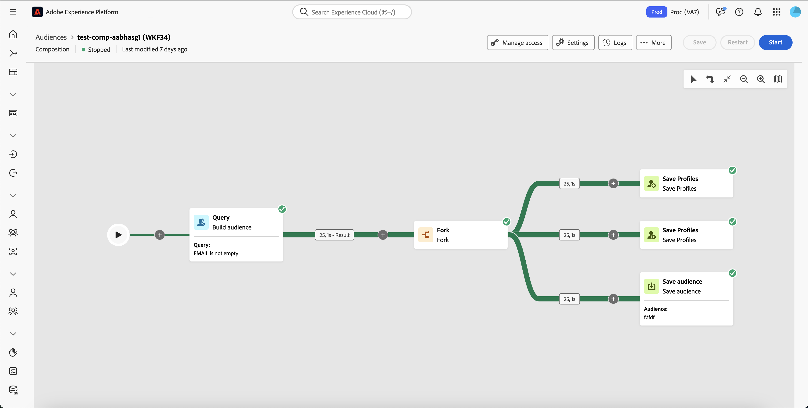
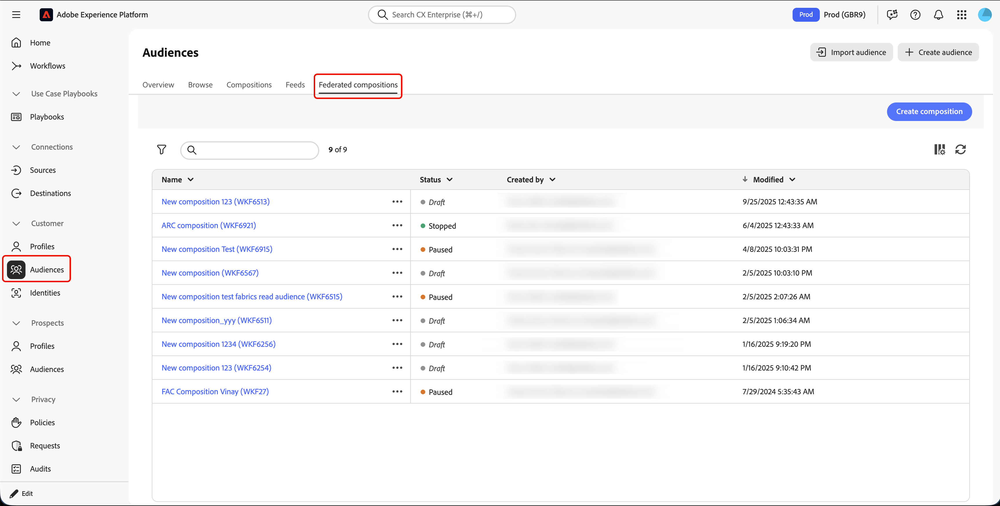
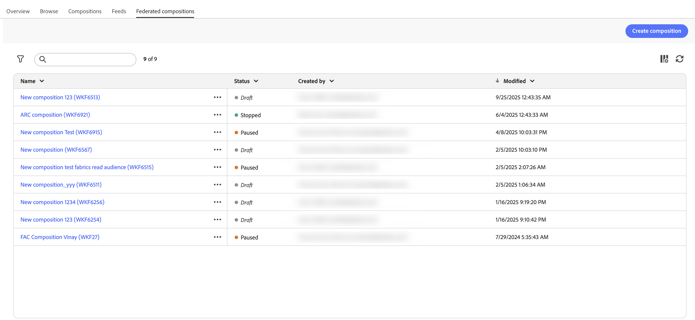
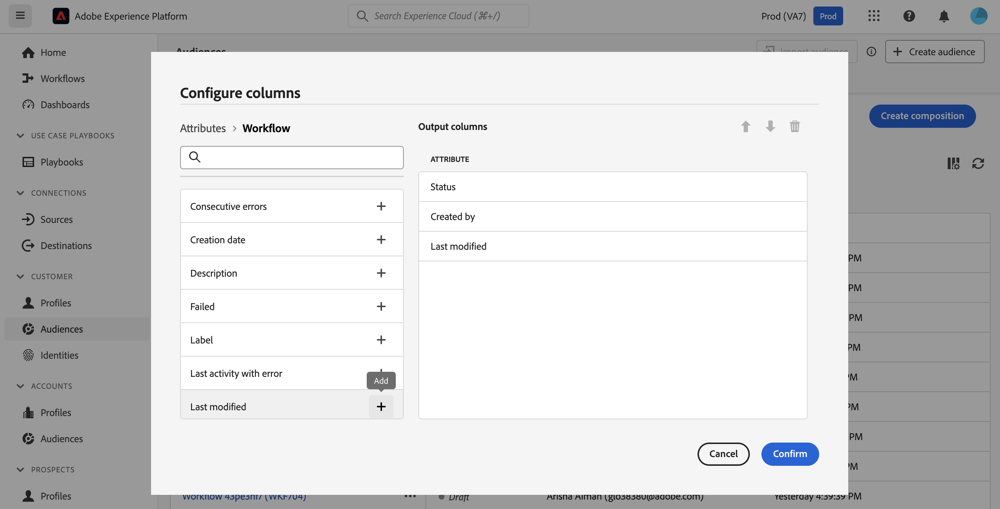
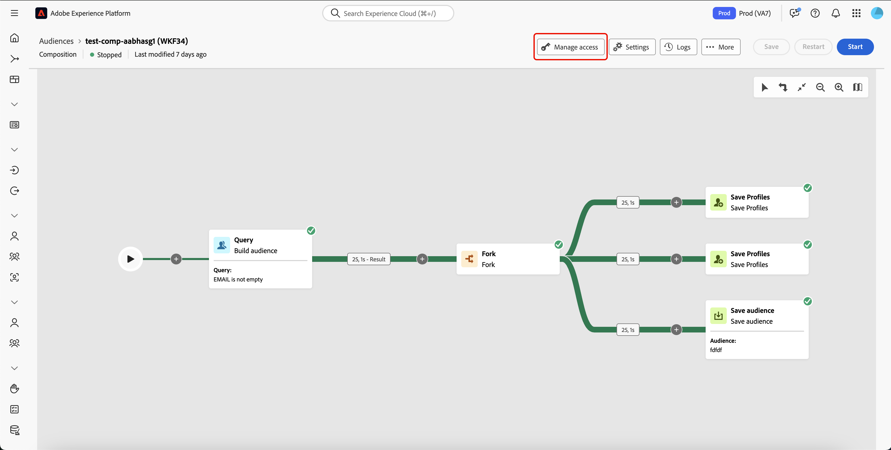
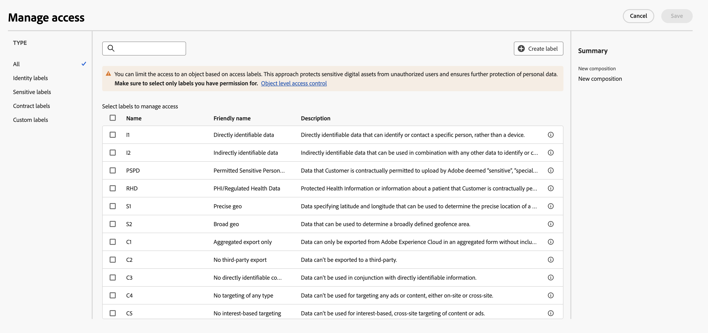

# Panoramica sulle composizioni

>[!AVAILABILITY]
>
>Per accedere alle composizioni, è necessario disporre di una delle seguenti autorizzazioni:
>
>-**Gestisci composizioni federate**
>-**Visualizzazione composizioni federate**
>
>Per ulteriori informazioni sulle autorizzazioni richieste, consulta la [Guida al controllo degli accessi](/help/governance-privacy-security/access-control.md).

La funzione Composizione di pubblico federato consente di creare composizioni, sfruttando varie attività in un’area di lavoro visiva per creare tipi di pubblico. Dopo aver creato la composizione, i tipi di pubblico risultanti vengono salvati in Adobe Experience Platform e possono essere sfruttati nelle destinazioni di Experience Platform e Adobe Journey Optimizer per il targeting della clientela.

{zoomable="yes"}{width="70%"}

## Componenti composizione {#components}

Una composizione all’interno di Federated Audience Composition è composta dalle seguenti parti:

- **[!UICONTROL Attività]**: un&#39;attività è un&#39;attività da eseguire ed è rappresentata all&#39;interno della composizione da icone.
- **[!UICONTROL Transizioni]**: le transizioni collegano un’attività di origine a un’attività di destinazione e ne definiscono la sequenza. Le informazioni contenute nelle transizioni vengono memorizzate in una tabella di lavoro. Ogni composizione utilizza diverse tabelle di lavoro. I dati trasmessi in queste tabelle possono essere utilizzati in tutto il ciclo di vita della composizione.

## Accesso e gestione delle composizioni {#access}

>[!CONTEXTUALHELP]
>id="dc_composition_list"
>title="Composizioni"
>abstract="In questa schermata, puoi accedere all’elenco completo delle composizioni, controllarne lo stato, le date dell’ultima/successiva esecuzione e creare una nuova composizione."

Le composizioni sono accessibili dal menu **[!UICONTROL Tipi di pubblico]** nella scheda **[!UICONTROL Composizioni federate]**, nella sezione **[!UICONTROL Cliente]**.

{zoomable="yes"}{width="70%"}

Da questa schermata è possibile visualizzare informazioni sulle composizioni e crearne di nuove.

{zoomable="yes"}{width="70%"}

| Campo | Descrizione |
| ----- | ----------- |
| **[!UICONTROL Nome]** | Nome della composizione. Se selezionate la composizione, potete modificarla. Per ulteriori informazioni sulla creazione e la modifica di composizioni, leggere la [guida alla creazione di una composizione](/help/compositions/create-composition.md). |
| **[!UICONTROL Stato]** | Stato della composizione. I valori possibili includono [!UICONTROL Bozza], [!UICONTROL In corso], [!UICONTROL Interrotto], [!UICONTROL In pausa] e [!UICONTROL Errato]. <ul><li>**[!UICONTROL Bozza]**: composizione creata e salvata.</li><li>**[!UICONTROL In corso]**: la composizione è stata eseguita ed è attualmente in esecuzione.</li><li>**[!UICONTROL Arrestato]**: l&#39;esecuzione della composizione è stata completata ed è stata interrotta.</li><li>**[!UICONTROL Sospeso]**: l&#39;esecuzione della composizione è stata sospesa.</li><li>**[!UICONTROL Errore]**: l&#39;esecuzione della composizione ha rilevato un errore. Per visualizzare ulteriori informazioni sull’errore, apri la composizione e accedi ai registri.</li></ul> Per informazioni su come avviare o interrompere una composizione, leggere la [guida alla creazione della composizione](./create-composition.md#monitor-logs). |
| **[!UICONTROL Creato da]** | Nome e indirizzo di posta elettronica della persona che ha creato la composizione. |
| **[!UICONTROL Modificato]** | Data e ora dell’ultimo aggiornamento della composizione. |

Puoi anche eseguire azioni rapide per le composizioni selezionando il pulsante  accanto al nome.

| Azione | Descrizione |
| ------ | ----------- |
| **[!UICONTROL Duplicato]** | Duplica la composizione selezionata. |
| **[!UICONTROL Elimina]** | Elimina la composizione selezionata. |
| **[!UICONTROL Aggiungi al pacchetto]** | Sposta la composizione tra sandbox. Per ulteriori informazioni su questa funzione, leggere la [guida agli strumenti della sandbox](https://experienceleague.adobe.com/en/docs/experience-platform/sandbox/ui/sandbox-tooling). |

Per perfezionare l’elenco e trovare la composizione che stai cercando, puoi filtrarlo in base agli stati delle composizioni o alle ultime date di elaborazione.

Puoi anche personalizzare l’elenco aggiungendo o rimuovendo colonne. A tale scopo, seleziona il pulsante **[!UICONTROL Configura colonne]** e aggiungi o rimuovi le colonne di output desiderate.

{zoomable="yes"}{width="70%"}

### Applicare le etichette di accesso {#access-labels}

Per applicare le etichette di accesso a una composizione specifica, seleziona la composizione e poi **[!UICONTROL Gestisci accesso]**.

{zoomable="yes"}{width="70%"}

Viene visualizzato il popover **[!UICONTROL Gestisci accesso]**. In questa pagina puoi applicare alla composizione le etichette di accesso e governance dei dati applicabili.

{zoomable="yes"}{width="70%"}

| Tipo etichetta | Descrizione |
| ---------- | ----------- |
| Etichette per contratti | Le etichette per contratti (“C”) vengono utilizzate per categorizzare i dati con obblighi contrattuali o relativi ai criteri di governance dei dati della tua organizzazione. |
| Etichette di identità | Le etichette di identità (“I”) vengono utilizzate per categorizzare i dati che possono essere identificare o contattare una persona specifica. |
| Etichette per dati sensibili | Le etichette per dati sensibili (“S”) vengono utilizzate per categorizzare i dati che tu o la tua organizzazione considerate come sensibili. |
| Etichette dell’ecosistema dei partner | Le etichette dell’ecosistema dei partner vengono utilizzate per categorizzare i dati provenienti da origini esterne all’organizzazione. |

Per ulteriori informazioni sull’utilizzo delle etichette di accesso e governance dei dati, consulta il [Glossario delle etichette di utilizzo dei dati](https://experienceleague.adobe.com/it/docs/experience-platform/data-governance/labels/reference).

## Creare {#create}

Puoi creare una composizione per Adobe Experience Platform utilizzando Composizione pubblico. Per ulteriori informazioni, leggere la [guida alla creazione di una composizione](./create-composition.md).

## Passaggi successivi

Con questa guida, hai imparato come accedere, gestire e creare etichette di accesso per le composizioni. Per ulteriori informazioni sull’utilizzo dei tipi di pubblico in generale, consulta la [guida ai tipi di pubblico](../start/audiences.md).
