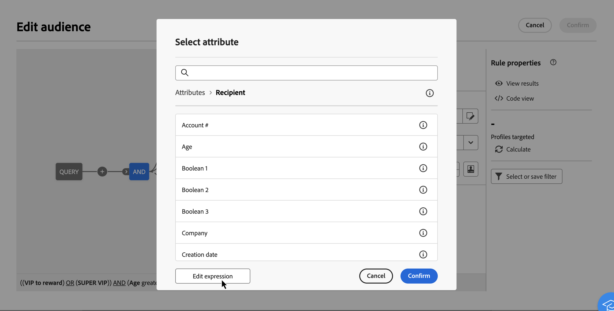
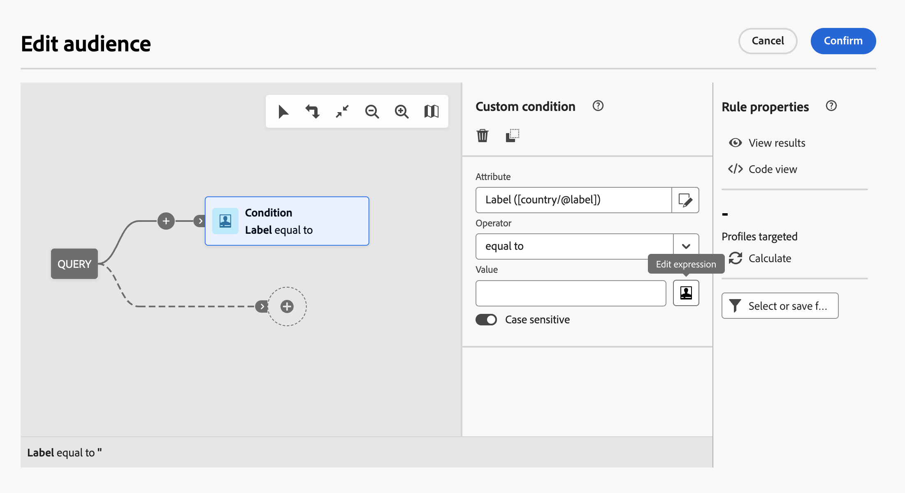
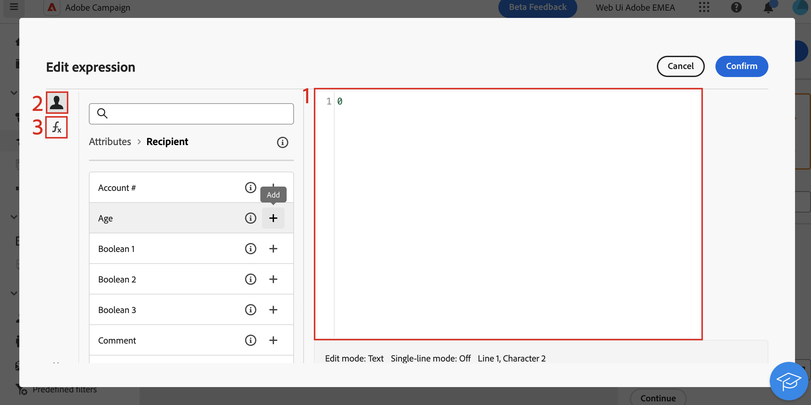
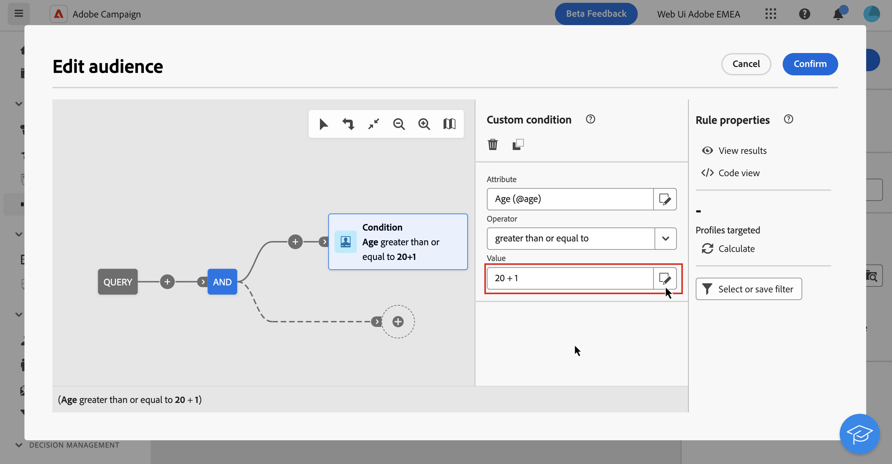

# Panoramica dell’editor espressioni {#expression}

La modifica di un’espressione comporta l’immissione manuale di condizioni per formare una regola. Questa modalità ti consente di utilizzare funzioni avanzate, che ti consentono di manipolare i valori utilizzati per eseguire query specifiche come la manipolazione di date, stringhe, campi numerici, ordinamenti, ecc.

## Utilizzare l’editor di espressioni {#edit}

L&#39;editor espressioni è disponibile dal pulsante **[!UICONTROL Modifica espressione]** del modellatore di query, disponibile per i campi **[!UICONTROL Attributo]** e **[!UICONTROL Valore]** durante la configurazione di una condizione personalizzata.

| Accedere dal campo **[!UICONTROL Attributo]** | Accedere dal campo **[!UICONTROL Valore]** |
|  ---  |  ---  |
| {zoomable="yes"}{width="200" align="center" zoomable="yes"} | {zoomable="yes"}{width="200" align="center" zoomable="yes"} |

L’editor di espressioni mostra:

* Un campo di input **(1)** in cui è definita l&#39;espressione.
* Elenco dei **campi (2)** disponibili che possono essere utilizzati nell&#39;espressione e corrispondenti allo schema della query, noto anche come dimensione di targeting.
* **Funzioni helper (3)**, ordinate per categoria.

Modifica l’espressione immettendo un’espressione direttamente nel campo di input. Per aggiungere un campo o una funzione di supporto, posiziona il cursore nell’espressione nel punto in cui desideri aggiungerlo e seleziona il pulsante +.

{zoomable="yes"}

Quando l&#39;espressione è pronta, selezionare **[!UICONTROL Conferma]**. L’espressione viene visualizzata nel campo selezionato. Per modificarlo, apri l’editor di espressioni e apporta le modifiche desiderate.

L&#39;esempio seguente mostra un&#39;espressione configurata per il campo **[!UICONTROL Value]**. Per modificarlo, è necessario aprire l&#39;editor espressioni utilizzando il pulsante **[!UICONTROL Modifica espressione]**.

{zoomable="yes"}

## Funzioni Helper

Lo strumento di modifica delle query consente di utilizzare funzioni avanzate per eseguire filtri complessi a seconda dei risultati desiderati e dei tipi di dati gestiti. Sono disponibili le seguenti funzioni:

### Data

Le funzioni di data vengono utilizzate per manipolare i valori di data o ora.

>[!BEGINTABS]

>[!TAB Google BigQuery]

| Nome | Descrizione | Sintassi | Esempio |
| ---- | ----------- | ------ | ------- |
| **AddYears** | Aggiunge il numero di anni specificato al datetime specificato. | AddYears(&lt;DATETIME>, &lt;NUMERO>) | AddYears(&quot;2019-12-25 15:30:00&quot;, 3) |
| **AddMonths** | Aggiunge il numero di mesi specificato al datetime specificato. | AddMonths(&lt;DATETIME>, &lt;NUMERO>) | AddMonths(&quot;2019-12-25 15:30:00&quot;, 6) |
| **AddDays** | Aggiunge il numero di giorni specificato al datetime specificato. | AddDays(&lt;DATETIME>, &lt;NUMERO>) | AddDays(&quot;2019-12-25 15:30:00&quot;, 10) |
| **AddHours** | Aggiunge il numero di ore specificato al datetime specificato. | AddHours(&lt;DATETIME>, &lt;NUMERO>) | AddHours(&quot;2019-12-25 15:30:00&quot;, 3) |
| **AddMinutes** | Aggiunge il numero di minuti specificato al datetime specificato. | AddMinutes(&lt;DATETIME>, &lt;NUMERO>) | AddMinutes(&quot;2019-12-25 15:30:00&quot;, 32) |
| **AddSeconds** | Aggiunge il numero di secondi specificato al datetime specificato. | AddSeconds(&lt;DATETIME>, &lt;NUMERO>) | AddSeconds(&quot;2019-12-25 15:30:00&quot;, 37) |
| **SubYears** | Sottrae il numero di anni specificato al datetime specificato. | SubYears(&lt;DATETIME>, &lt;NUMERO>) | SubYears(&quot;2019-12-25 15:30:00&quot;, 3) |
| **SubMonths** | Sottrae il numero di mesi specificato alla data/ora specificata. | SubMonths(&lt;DATETIME>, &lt;NUMERO>) | SubMonths(&quot;2019-12-25 15:30:00&quot;, 6) |
| **SubDays** | Sottrae il numero di giorni specificato al datetime specificato. | SubDays(&lt;DATETIME>, &lt;NUMERO>) | SubDays(&quot;2019-12-25 15:30:00&quot;, 10) |
| **SubHours** | Sottrae il numero di ore specificato al datetime specificato. | SubHours(&lt;DATETIME>, &lt;NUMERO>) | SubHours(&quot;2019-12-25 15:30:00&quot;, 3) |
| **SubMinutes** | Sottrae il numero di minuti specificato al datetime specificato. | SubMinutes(&lt;DATETIME>, &lt;NUMERO>) | SubMinutes(&quot;2019-12-25 15:30:00&quot;, 32) |
| **SubSeconds** | Sottrae il numero di secondi specificato al datetime specificato. | SubSeconds(&lt;DATETIME>, &lt;NUMERO>) | SubSeconds(&quot;2019-12-25 15:30:00&quot;, 37) |
| **Year** | Estrae l&#39;anno dall&#39;oggetto datetime specificato. | Year(&lt;DATETIME>) | Year(&quot;2019-12-15 15:30:00&quot;) |
| **Month** | Estrae il mese dall&#39;oggetto datetime specificato. | Month(&lt;DATAORA>) | Mese(&quot;2019-12-15 15:30:00&quot;) |
| **Day** | Estrae il giorno dall&#39;oggetto datetime specificato. | Day(&lt;DATETIME>) | Day(&quot;2019-12-15 15:30:00&quot;) |
| **DayOfYear** | Estrae il giorno dell&#39;anno dall&#39;oggetto datetime specificato. Ad esempio, se il valore datetime fornito è il 2 febbraio, restituirà 33. | DayOfYear(&lt;DATETIME>) | DayOfYear(&quot;2019-12-15 15:30:00&quot;) |
| **WeekDay** | Estrae il giorno della settimana dall&#39;oggetto datetime specificato, come numero compreso tra 0 e 6, con 0 che rappresenta la domenica. | Year(&lt;DATETIME>) | Year(&quot;2019-12-15 15:30:00&quot;) |
| **Hour** | Estrae il valore dell&#39;ora dall&#39;oggetto datetime specificato. | Year(&lt;DATETIME>) | Year(&quot;2019-12-15 15:30:00&quot;) |
| **Minute** | Estrae il valore del minuto dall&#39;oggetto datetime specificato. | Year(&lt;DATETIME>) | Year(&quot;2019-12-15 15:30:00&quot;) |
| **Second** | Estrae il secondo valore dall&#39;oggetto datetime specificato. | Year(&lt;DATETIME>) | Year(&quot;2019-12-15 15:30:00&quot;) |
| **YearsDiff** | Trova la differenza tra le date specificate, con una granularità di anni. | YearsDiff(&lt;DATETIME>, &lt;DATETIME>) | YearsDiff(&quot;2019-12-25 15:30:00&quot;, &quot;2018-10-14 18:35:27&quot;) |
| **MonthsDiff** | Trova la differenza tra le date specificate, con una granularità di mesi. | MonthsDiff(&lt;DATAORA>, &lt;DATAORA>) | MonthsDiff(&quot;2019-12-25 15:30:00&quot;, &quot;2018-10-14 18:35:27&quot;) |
| **DaysDiff** | Trova la differenza tra le date specificate, con una granularità di giorni. | DaysDiff(&lt;DATETIME>, &lt;DATETIME>) | DaysDiff(&quot;2019-12-25 15:30:00&quot;, &quot;2018-10-14 18:35:27&quot;) |
| **HoursDiff** | Trova la differenza tra le date specificate, con una granularità di ore. | HoursDiff(&lt;DATETIME>, &lt;DATETIME>) | HoursDiff(&quot;2019-12-25 15:30:00&quot;, &quot;2018-10-14 18:35:27&quot;) |
| **MinutesDiff** | Trova la differenza tra le date specificate, con una granularità di minuti. | MinutesDiff(&lt;DATETIME>, &lt;DATETIME>) | MinutesDiff(&quot;2019-12-25 15:30:00&quot;, &quot;2018-10-14 18:35:27&quot;) |
| **SecondsDiff** | Trova la differenza tra le date specificate, con una granularità di secondi. | SecondsDiff(&lt;DATETIME>, &lt;DATETIME>) | SecondsDiff(&quot;2019-12-25 15:30:00&quot;, &quot;2018-10-14 18:35:27&quot;) |
| **YearsOld** | Trova la differenza tra il datetime specificato e il presente, con una granularità di anni. | YearsOld(&lt;DATETIME>) | YearsOld(&quot;2019-12-25 15:30:00&quot;) |
| **MonthsOld** | Trova la differenza tra il dato datetime e il presente, con una granularità di mesi. | MonthsOld(&lt;DATAORA>) | MonthsOld(&quot;2019-12-25 15:30:00&quot;) |
| **DaysOld** | Trova la differenza tra il dato datetime e il presente, con una granularità di giorni. | DaysOld(&lt;DATETIME>) | DaysOld(&quot;2019-12-25 15:30:00&quot;) |
| **GetDate** | Ottiene la data corrente del server. | GetDate() | GetDate() |
| **DateOnly** | Tronca il datetime solo all&#39;anno, al mese e al giorno. | DateOnly(&lt;DATETIME>) | DateOnly(&quot;2019-12-25 15:30:00&quot;) |
| **ToDate** | Converte il campo in un campo data. | ToDate(&lt;DATETIME>) | ToDate(&quot;2019-12-25 15:30:00&quot;) |
| **ToDateTime** | Converte il campo in un campo datetime. | ToDateTime(&lt;DATA>) | ToDateTime(&quot;2019-12-25 15:30:00&quot;) |
| **ATimestamp** | Converte il campo in un campo timestamp. | ToTimestamp(&lt;DATETIME>) | ToTimestamp(&quot;2019-12-25 15:30:00&quot;) |
| **Oldest** | Restituisce la data meno recente tra i due specificati. | Oldest(&lt;DATAORA>, &lt;DATAORA>) | Oldest(&quot;2015-02-13 11:59:59&quot;, &quot;2016-04-13 19:28:14&quot;) |
| **TruncDate** | Tronca il datetime all&#39;unità più vicina, in base al valore numerico specificato. Se il valore numerico è uguale a 60, viene troncato al minuto più vicino. Se il valore numerico è uguale a 3600, viene troncato all&#39;ora più vicina. Se il valore numerico è uguale a 86400, viene troncato al giorno più vicino. In caso contrario, viene troncato al secondo più vicino. | TruncDate(&lt;DATETIME>, &lt;NUMERO>) | TruncDate(&quot;2016-04-13 19:28:14&quot;, 3600) |
| **TruncDateTZ** | Tronca il datetime all&#39;unità più vicina, in base al valore numerico specificato, e imposta il datetime sul fuso orario specificato. Se il valore numerico è uguale a 60, viene troncato al minuto più vicino. Se il valore numerico è uguale a 3600, viene troncato all&#39;ora più vicina. Se il valore numerico è uguale a 86400, viene troncato al giorno più vicino. | TruncDateTZ(&lt;DATETIME>, &lt;NUMERO>, &lt;FUSO ORARIO>) | TruncDateTZ(&quot;2016-04-13 19:28:14&quot;, 3600, &quot;America/Los_Angeles&quot;) |
| **TruncTime** | Imposta il valore datetime su 1 gennaio 2000 e arrotonda il resto del valore datetime all&#39;unità più vicina, in base al valore numerico specificato.Se il valore numerico è uguale a 60, viene troncato al minuto più vicino. Se il valore numerico è uguale a 3600, viene troncato all&#39;ora più vicina. | TruncTime(&lt;DATETIME>, &lt;NUMERO>) | TruncTime(&quot;2016-04-13 19:28:14&quot;, 3600) |
| **TruncQuarter** | Tronca il datetime alla prima data nel trimestre più vicino. | TruncQuarter(&lt;DATETIME>) | TruncQuarter(&quot;2016-04-13 19:28:14&quot;) |
| **TruncYear** | Tronca il datetime alla prima data dell&#39;anno più vicino. | TruncYear(&lt;DATETIME>) | TruncYear(&quot;2016-04-13 19:28:14&quot;) |
| **TruncWeek** | Tronca il datetime alla domenica della settimana più vicina. | TruncWeek(&lt;DATETIME>) | TruncWeek(&quot;2016-04-13 19:28:14&quot;) |

>[!TAB Snowflake]

| Nome | Descrizione | Sintassi | Esempio |
| ---- | ----------- | ------ | ------- |
| **AddYears** | Aggiunge il numero di anni specificato al datetime specificato. | AddYears(&lt;DATETIME>, &lt;NUMERO>) | AddYears(&quot;2019-12-25 15:30:00&quot;, 3) |
| **AddMonths** | Aggiunge il numero di mesi specificato al datetime specificato. | AddMonths(&lt;DATETIME>, &lt;NUMERO>) | AddMonths(&quot;2019-12-25 15:30:00&quot;, 6) |
| **AddDays** | Aggiunge il numero di giorni specificato al datetime specificato. | AddDays(&lt;DATETIME>, &lt;NUMERO>) | AddDays(&quot;2019-12-25 15:30:00&quot;, 10) |
| **AddHours** | Aggiunge il numero di ore specificato al datetime specificato. | AddHours(&lt;DATETIME>, &lt;NUMERO>) | AddHours(&quot;2019-12-25 15:30:00&quot;, 3) |
| **AddMinutes** | Aggiunge il numero di minuti specificato al datetime specificato. | AddMinutes(&lt;DATETIME>, &lt;NUMERO>) | AddMinutes(&quot;2019-12-25 15:30:00&quot;, 32) |
| **AddSeconds** | Aggiunge il numero di secondi specificato al datetime specificato. | AddSeconds(&lt;DATETIME>, &lt;NUMERO>) | AddSeconds(&quot;2019-12-25 15:30:00&quot;, 37) |
| **SubYears** | Sottrae il numero di anni specificato al datetime specificato. | SubYears(&lt;DATETIME>, &lt;NUMERO>) | SubYears(&quot;2019-12-25 15:30:00&quot;, 3) |
| **SubMonths** | Sottrae il numero di mesi specificato alla data/ora specificata. | SubMonths(&lt;DATETIME>, &lt;NUMERO>) | SubMonths(&quot;2019-12-25 15:30:00&quot;, 6) |
| **SubDays** | Sottrae il numero di giorni specificato al datetime specificato. | SubDays(&lt;DATETIME>, &lt;NUMERO>) | SubDays(&quot;2019-12-25 15:30:00&quot;, 10) |
| **SubHours** | Sottrae il numero di ore specificato al datetime specificato. | SubHours(&lt;DATETIME>, &lt;NUMERO>) | SubHours(&quot;2019-12-25 15:30:00&quot;, 3) |
| **SubMinutes** | Sottrae il numero di minuti specificato al datetime specificato. | SubMinutes(&lt;DATETIME>, &lt;NUMERO>) | SubMinutes(&quot;2019-12-25 15:30:00&quot;, 32) |
| **SubSeconds** | AdSottrae il numero di secondi specificato al valore datetime specificato. | SubSeconds(&lt;DATETIME>, &lt;NUMERO>) | SubSeconds(&quot;2019-12-25 15:30:00&quot;, 37) |
| **Year** | Estrae l&#39;anno dall&#39;oggetto datetime specificato. | Year(&lt;DATETIME>) | Year(&quot;2019-12-15 15:30:00&quot;) |
| **Month** | Estrae il mese dall&#39;oggetto datetime specificato. | Month(&lt;DATAORA>) | Mese(&quot;2019-12-15 15:30:00&quot;) |
| **Day** | Estrae il giorno dall&#39;oggetto datetime specificato. | Day(&lt;DATETIME>) | Day(&quot;2019-12-15 15:30:00&quot;) |
| **DayOfYear** | Estrae il giorno dell&#39;anno dall&#39;oggetto datetime specificato. Ad esempio, se il valore datetime fornito è il 2 febbraio, restituirà 33. | DayOfYear(&lt;DATETIME>) | DayOfYear(&quot;2019-12-15 15:30:00&quot;) |
| **WeekDay** | Estrae il giorno della settimana dall&#39;oggetto datetime specificato, come numero compreso tra 1 e 7, con 1 che rappresenta la domenica. | Year(&lt;DATETIME>) | Year(&quot;2019-12-15 15:30:00&quot;) |
| **Hour** | Estrae il valore dell&#39;ora dall&#39;oggetto datetime specificato. | Year(&lt;DATETIME>) | Year(&quot;2019-12-15 15:30:00&quot;) |
| **Minute** | Estrae il valore del minuto dall&#39;oggetto datetime specificato. | Year(&lt;DATETIME>) | Year(&quot;2019-12-15 15:30:00&quot;) |
| **Second** | Estrae il secondo valore dall&#39;oggetto datetime specificato. | Year(&lt;DATETIME>) | Year(&quot;2019-12-15 15:30:00&quot;) |
| **YearsDiff** | Trova la differenza tra le date specificate, con una granularità di anni. | YearsDiff(&lt;DATETIME>, &lt;DATETIME>) | YearsDiff(&quot;2019-12-25 15:30:00&quot;, &quot;2018-10-14 18:35:27&quot;) |
| **MonthsDiff** | Trova la differenza tra le date specificate, con una granularità di mesi. | MonthsDiff(&lt;DATAORA>, &lt;DATAORA>) | MonthsDiff(&quot;2019-12-25 15:30:00&quot;, &quot;2018-10-14 18:35:27&quot;) |
| **DaysDiff** | Trova la differenza tra le date specificate, con una granularità di giorni. | DaysDiff(&lt;DATETIME>, &lt;DATETIME>) | DaysDiff(&quot;2019-12-25 15:30:00&quot;, &quot;2018-10-14 18:35:27&quot;) |
| **HoursDiff** | Trova la differenza tra le date specificate, con una granularità di ore. | HoursDiff(&lt;DATETIME>, &lt;DATETIME>) | HoursDiff(&quot;2019-12-25 15:30:00&quot;, &quot;2018-10-14 18:35:27&quot;) |
| **MinutesDiff** | Trova la differenza tra le date specificate, con una granularità di minuti. | MinutesDiff(&lt;DATETIME>, &lt;DATETIME>) | MinutesDiff(&quot;2019-12-25 15:30:00&quot;, &quot;2018-10-14 18:35:27&quot;) |
| **SecondsDiff** | Trova la differenza tra le date specificate, con una granularità di secondi. | SecondsDiff(&lt;DATETIME>, &lt;DATETIME>) | SecondsDiff(&quot;2019-12-25 15:30:00&quot;, &quot;2018-10-14 18:35:27&quot;) |
| **MonthsOld** | Trova la differenza tra il dato datetime e il presente, con una granularità di mesi. | MonthsOld(&lt;DATAORA>) | MonthsOld(&quot;2019-12-25 15:30:00&quot;) |
| **DaysOld** | Trova la differenza tra il dato datetime e il presente, con una granularità di giorni. | DaysOld(&lt;DATETIME>) | DaysOld(&quot;2019-12-25 15:30:00&quot;) |
| **GetDate** | Ottiene la data corrente del server. | GetDate() | GetDate() |
| **DateOnly** | Tronca il datetime solo all&#39;anno, al mese e al giorno. | DateOnly(&lt;DATETIME>) | DateOnly(&quot;2019-12-25 15:30:00&quot;) |
| **ToDate** | Converte il campo in un campo data. | ToDate(&lt;DATETIME>) | ToDate(&quot;2019-12-25 15:30:00&quot;) |
| **ToDateTime** | Converte il campo in un campo datetime. | ToDateTime(&lt;DATA>) | ToDateTime(&quot;2019-12-25 15:30:00&quot;) |
| **ATimestamp** | Converte il campo in un campo timestamp. | ToTimestamp(&lt;DATETIME>) | ToTimestamp(&quot;2019-12-25 15:30:00&quot;) |
| **Oldest** | Restituisce la data meno recente tra i due specificati. | Oldest(&lt;DATAORA>, &lt;DATAORA>) | Oldest(&quot;2015-02-13 11:59:59&quot;, &quot;2016-04-13 19:28:14&quot;) |
| **TruncDate** | Tronca il datetime all&#39;unità più vicina, in base al valore numerico specificato. Se il valore numerico è uguale a 60, viene troncato al minuto più vicino. Se il valore numerico è uguale a 3600, viene troncato all&#39;ora più vicina. Se il valore numerico è uguale a 86400, viene troncato al giorno più vicino. In caso contrario, viene troncato al secondo più vicino. | TruncDate(&lt;DATETIME>, &lt;NUMERO>) | TruncDate(&quot;2016-04-13 19:28:14&quot;, 3600) |
| **TruncDateTZ** | Tronca il datetime all&#39;unità più vicina, in base al valore numerico specificato, e imposta il datetime sul fuso orario specificato. Se il valore numerico è uguale a 60, viene troncato al minuto più vicino. Se il valore numerico è uguale a 3600, viene troncato all&#39;ora più vicina. Se il valore numerico è uguale a 86400, viene troncato al giorno più vicino. | TruncDateTZ(&lt;DATETIME>, &lt;NUMERO>, &lt;FUSO ORARIO>) | TruncDateTZ(&quot;2016-04-13 19:28:14&quot;, 3600, &quot;America/Los_Angeles&quot;) |
| **TruncTime** | Imposta il valore datetime su 1 gennaio 2000 e arrotonda il resto del valore datetime all&#39;unità più vicina, in base al valore numerico specificato.Se il valore numerico è uguale a 60, viene troncato al minuto più vicino. Se il valore numerico è uguale a 3600, viene troncato all&#39;ora più vicina. | TruncTime(&lt;DATETIME>, &lt;NUMERO>) | TruncTime(&quot;2016-04-13 19:28:14&quot;, 3600) |
| **TruncQuarter** | Tronca il datetime alla prima data nel trimestre più vicino. | TruncQuarter(&lt;DATETIME>) | TruncQuarter(&quot;2016-04-13 19:28:14&quot;) |
| **TruncYear** | Tronca il datetime alla prima data dell&#39;anno più vicino. | TruncYear(&lt;DATETIME>) | TruncYear(&quot;2016-04-13 19:28:14&quot;) |
| **TruncWeek** | Tronca il datetime alla domenica della settimana più vicina. | TruncWeek(&lt;DATETIME>) | TruncWeek(&quot;2016-04-13 19:28:14&quot;) |
| **ConvertNTZ** | Converte una marca temporale senza fuso orario in una marca temporale con fuso orario. Il fuso orario associato sarà quello dell’account esterno. | ConvertNTZ(&lt;DATETIME>) | ConvertNTZ(&quot;2024-06-24 14:43:49&quot;) |

>[!ENDTABS]

>[!NOTE]
>
>Tieni presente che la funzione **Dateonly** tiene conto del fuso orario del server, non di quello dell’operatore.

### Geomarketing

Le funzioni di geomarketing vengono utilizzate per manipolare i valori geografici.

>[!BEGINTABS]

>[!TAB Google BigQuery]

| Nome | Descrizione | Sintassi | Esempio |
| ---- | ----------- | ------ | ------- |
| **Distance** | Restituisce la distanza tra due punti definiti da longitudine e latitudine in gradi, sotto forma di doppio. | Distance(&lt;NUMERO>, &lt;NUMERO>, &lt;NUMERO>, &lt;NUMERO>) | Distanza (40,345; 39,2345; -35,5834; 34,599) |

>[!TAB Snowflake]

| Nome | Descrizione | Sintassi | Esempio |
| ---- | ----------- | ------ | ------- |
| **Distance** | Restituisce la distanza tra due punti definiti da longitudine e latitudine in gradi, sotto forma di doppio. | Distance(&lt;NUMERO>, &lt;NUMERO>, &lt;NUMERO>, &lt;NUMERO>) | Distanza (40,345; 39,2345; -35,5834; 34,599) |

>[!ENDTABS]

### Numeriche

Le funzioni numeriche vengono utilizzate per convertire il testo in numeri.

>[!BEGINTABS]

>[!TAB Google BigQuery]

| Nome | Descrizione | Sintassi | Esempio |
| ---- | ----------- | ------ | ------- |
| **Mod** | Restituisce il resto del primo numero diviso per il secondo numero. | Mod(&lt;NUMERO>, &lt;NUMERO>) | Mod (3, 2) |
| **Percent** | Calcola la percentuale del primo numero rispetto al secondo numero. | Percentuale(&lt;NUMERO>, &lt;NUMERO>) | Percentuale (1, 2) |
| **Random** | Restituisce un numero casuale compreso tra 0 (inclusi) e 1 (esclusi). | Random() | Casuale () |
| **Round** | Restituisce il numero fornito alla cifra decimale richiesta più vicina. | Round(&lt;NUMERO>, &lt;NUMERO>) | Round(4,5394, 2) |
| **ToDouble** | Converte il numero fornito in un doppio. | ToDouble(&lt;NUMERO>) | ToDouble(5) |
| **ToInteger** | Converte il numero fornito in un numero intero. | ToInteger(&lt;NUMERO>) | ToInteger(45) |
| **ToInt64** | Converte il numero fornito in un numero intero a 64 bit. | ToInt64(&lt;NUMERO>) | ToInt64 (493) |
| **Trunc** | Tronca il numero fornito al numero richiesto di cifre decimali. | Trunc(&lt;NUMERO>, &lt;NUMERO>) | Trunc(36,9348934, 3) |

>[!TAB Snowflake]

| Nome | Descrizione | Sintassi | Esempio |
| ---- | ----------- | ------ | ------- |
| **Mod** | Restituisce il resto del primo numero diviso per il secondo numero. | Mod(&lt;NUMERO>, &lt;NUMERO>) | Mod (3, 2) |
| **Percent** | Calcola la percentuale del primo numero rispetto al secondo numero. | Percentuale(&lt;NUMERO>, &lt;NUMERO>) | Percentuale (1, 2) |
| **Random** | Restituisce un numero casuale compreso tra 0 (inclusi) e 1 (esclusi). | Random() | Casuale () |
| **ToDouble** | Converte il numero fornito in un doppio. | ToDouble(&lt;NUMERO>) | ToDouble(5) |
| **ToInteger** | Converte il numero fornito in un numero intero. | ToInteger(&lt;NUMERO>) | ToInteger(45) |
| **ToInt64** | Converte il numero fornito in un numero intero a 64 bit. | ToInt64(&lt;NUMERO>) | ToInt64 (493) |
| **Trunc** | Tronca il numero fornito al numero richiesto di cifre decimali. | Trunc(&lt;NUMERO>, &lt;NUMERO>) | Trunc(36,9348934, 3) |

>[!ENDTABS]

### Altre

Questa tabella contiene le altre funzioni disponibili.

>[!BEGINTABS]

>[!TAB Google BigQuery]

| Nome | Descrizione | Sintassi | Esempio |
| ---- | ----------- | ------ | ------- |
| **Case** | Restituisce il primo valore se l’espressione è true. In caso contrario, restituisce il secondo valore. | Case(When(&lt;ESPRESSIONE> &lt;VALORE>), Else(&lt;VALORE>)) | Case(When(a > b, &quot;yes&quot;), Else(&quot;no&quot;)) |
| **When** | Utilizzato come parte della funzione Case. Utilizzato per controllare l’espressione all’interno di Case. | When(&lt;ESPRESSIONE> &lt;VALORE>) | Quando(a > b, &quot;yes&quot;) |
| **Else** | Utilizzato come parte della funzione Case. Utilizzato per scegliere l’altra opzione, se l’espressione When è false. | Else(&lt;VALORE>) | Else (&quot;no&quot;) |
| **Coalesce** | Restituisce il primo valore non nullo. | Coalesce(&lt;VALORE>, &lt;VALORE>) | Coalesce (&quot;&quot;, &quot;string&quot;) |
| **Decode** | Restituisce la prima opzione se i valori sono uguali. Restituisce la seconda opzione se i valori non sono uguali. | Decode(&lt;VALORE>, &lt;VALORE>, &lt;VALORE>, &lt;VALORE>) | Decode(1, 2, &quot;true&quot;, &quot;false&quot;) |
| **GetEmailDomain** | Estrae il dominio dall’indirizzo e-mail fornito. | GetEmailDomain(&lt;STRINGA>) | GetEmailDomain(&quot;`sample@example.com`&quot;) |
| **Iif** | Restituisce la prima opzione se la condizione è true e restituisce la seconda opzione se la condizione è false. | Iif(&lt;CONDIZIONE>, &lt;VALORE>, &lt;VALORE>) | Iif(10 &lt; 20, &quot;true&quot;, &quot;false&quot;) |
| **IsEmptyString** | Restituisce la prima opzione se la stringa è vuota. In caso contrario, restituisce la seconda opzione. | IsEmptyString( &lt;STRINGA> ,&lt;VALORE>, &lt;VALORE>) | IsEmptyString(&quot;stringa&quot;, &quot;sì&quot;, &quot;no&quot;) |
| **NewUUID** | Genera un nuovo UUID univoco. | NewUUID() | NewUUID() |
| **NoNull** | Restituisce la stringa fornita se non è vuota e restituisce una stringa vuota se la stringa fornita è vuota. | NoNull(&lt;STRINGA>) | NoNull(&quot;test&quot;) |
| **IsBitSet** | Esegue una e (&amp;) bit per bit sui numeri forniti. Questo consente di verificare se il bit all’interno del primo parametro è impostato nella posizione fornita nel secondo parametro. | IsBitSet(&lt;NUMERO>, &lt;NUMERO>) | IsBitSet(5, 3) |
| **ClearBit** | Questo consente di cancellare il bit all’interno del primo parametro nella posizione fornita nel secondo parametro. | ClearBit(&lt;NUMERO>, &lt;NUMERO>) | |
| **SetBit** | Esegue un o (\|) bit per bit sui numeri specificati. Questo consente di impostare il bit all&#39;interno del primo parametro in modo che sia impostato nella posizione specificata nel secondo parametro. | SetBit(&lt;NUMERO>, &lt;NUMERO>) | SetBit(5, 3) |
| **RowId** | Restituisce il numero di riga. | RowId() | RowId() |
| **ToBoolean** | Converte il valore in booleano. | ToBoolean(&lt;VALORE>) | ToBoolean(a=b) |

>[!TAB Snowflake]

| Nome | Descrizione | Sintassi | Esempio |
| ---- | ----------- | ------ | ------- |
| **Case** | Restituisce il primo valore se l’espressione è true. In caso contrario, restituisce il secondo valore. | Case(When(&lt;ESPRESSIONE> &lt;VALORE>), Else(&lt;VALORE>)) | Case(When(a > b, &quot;yes&quot;), Else(&quot;no&quot;)) |
| **When** | Utilizzato come parte della funzione Case. Utilizzato per controllare l’espressione all’interno di Case. | When(&lt;ESPRESSIONE> &lt;VALORE>) | Quando(a > b, &quot;yes&quot;) |
| **Else** | Utilizzato come parte della funzione Case. Utilizzato per scegliere l’altra opzione, se l’espressione When è false. | Else(&lt;VALORE>) | Else (&quot;no&quot;) |
| **GetEmailDomain** | Estrae il dominio dall’indirizzo e-mail fornito. | GetEmailDomain(&lt;STRINGA>) | GetEmailDomain(&quot;`sample@example.com`&quot;) |
| **Iif** | Restituisce la prima opzione se la condizione è true e restituisce la seconda opzione se la condizione è false. | Iif(&lt;CONDIZIONE>, &lt;VALORE>, &lt;VALORE>) | Iif(10 &lt; 20, &quot;true&quot;, &quot;false&quot;) |
| **IsEmptyString** | Restituisce la prima opzione se la stringa è vuota. In caso contrario, restituisce la seconda opzione. | IsEmptyString( &lt;STRINGA> ,&lt;VALORE>, &lt;VALORE>) | IsEmptyString(&quot;stringa&quot;, &quot;sì&quot;, &quot;no&quot;) |
| **ToBoolean** | Restituisce 1 se il valore è true. Restituisce 0 se il valore è false. | ToBoolean(&lt;VALORE>) | ToBoolean(a=b) |
| **ToBooleanType** | Converte il valore in booleano. | ToBooleanType(&lt;VALORE>) | ToBooleanType(a=b) |
| **IsBitSet** | Esegue una e (&amp;) bit per bit sui numeri forniti. Questo consente di verificare se il bit all’interno del primo parametro è impostato nella posizione fornita nel secondo parametro. | IsBitSet(&lt;NUMERO>, &lt;NUMERO>) | IsBitSet(5, 3) |
| **ClearBit** | Questo consente di cancellare il bit all’interno del primo parametro nella posizione fornita nel secondo parametro. | ClearBit(&lt;NUMERO>, &lt;NUMERO>) | |
| **SetBit** | Esegue un o (\|) bit per bit sui numeri specificati. Questo consente di impostare il bit all&#39;interno del primo parametro in modo che sia impostato nella posizione specificata nel secondo parametro. | SetBit(&lt;NUMERO>, &lt;NUMERO>) | SetBit(5, 3) |
| **RowId** | Restituisce il numero di riga. | RowId() | RowId() |
| **NewUUID** | Genera un nuovo UUID univoco. | NewUUID() | NewUUID() |
| **NoNull** | Restituisce la stringa fornita se non è vuota e restituisce una stringa vuota se la stringa fornita è vuota. | NoNull(&lt;STRINGA>) | NoNull(&quot;test&quot;) |
| **AESEncrypt** | Crittografa la stringa fornita con il tipo di crittografia AES. | AESEncrypt() | AESEncrypt(&quot;hello&quot;) |
| **Oggetto** | Crea un oggetto in base alle coppie chiave/valore fornite. | ObjectConstruct(&lt;STRINGA>, &lt;STRINGA>) | ObjectConstruct(&quot;key&quot;, &quot;value&quot;) |

>[!ENDTABS]

### Stringa

Le funzioni di stringa vengono utilizzate per manipolare un insieme di stringhe.

>[!BEGINTABS]

>[!TAB Google BigQuery]

| Nome | Descrizione | Sintassi | Esempio |
| ---- | ----------- | ------ | ------- |
| **AllNonNull2** | Accetta due stringhe e controlla se tutte non sono nulle e non sono vuote. | AllNonNull2(&lt;STRINGA>, &lt;STRINGA>) | AllNonNull2(&quot;&quot;, &quot;string2&quot;) |
| **AllNonNull3** | Richiede tre stringhe e verifica se tutte non sono nulle e non sono vuote | AllNonNull3(&lt;STRINGA>, &lt;STRINGA>, &lt;STRINGA>) | AllNonNull3(&quot;, &quot;one&quot;, &quot;three&quot;) |
| **Ascii** | Prende una stringa e restituisce il risultato . | Ascii(&lt;STRINGA>) | Ascii (&quot;foo&quot;) |
| **Char** | Accetta un array di punti di codice Unicode e restituisce la stringa risultante. | Char(&lt;ARRAY>) | Char([65, 68, 79, 66, 69]) |
| **Charindex** | Trova la prima occorrenza della sottostringa specificata nella stringa principale. | Charindex(&lt;STRINGA>, &lt;SOTTOSTRINGA>) | Charindex (&quot;bar@example.com&quot;, &quot;@&quot;) |
| **dataLength** | Restituisce il numero di byte nella stringa. | dataLength(&lt;STRINGA>) | dataLength(&quot;La mia stringa&quot;) |
| **GetLine** | Restituisce la riga richiesta della stringa specificata. | GetLine(&lt;STRINGA>, &lt;NUMERO>) | GetLine(multilinestring, 5) |
| **IfEquals** | Prende quattro stringhe e restituisce la terza stringa se le prime due stringhe sono uguali e restituisce la quarta stringa se le prime due stringhe non sono uguali. | IfEquals(&lt;STRINGA>, &lt;STRINGA>, &lt;STRINGA>, &lt;STRINGA>) | IfEquals(&quot;a&quot;, &quot;a&quot;, &quot;yes&quot;, &quot;no&quot;) |
| **IsMemoNull** | Restituisce 1 se la stringa è null, altrimenti restituisce 0. | IsMemoNull(&lt;STRINGA>) | IsMemoNull(&quot;hello&quot;) |
| **JuxtWords** | Prende due stringhe e le combina in una singola stringa. Se necessario, vengono aggiunti spazi tra le stringhe. | JuxtWords(&lt;STRINGA>, &lt;STRINGA>) | JuxtWords(&quot;Hello&quot;, &quot;World&quot;) |
| **JuxtWords3** | Prende tre stringhe e le combina in una singola stringa. Se necessario, vengono aggiunti spazi tra le stringhe. | JuxtWords3(&lt;STRINGA>, &lt;STRINGA>, &lt;STRINGA>) | JuxtWords3(&quot;Hello&quot;, &quot;New&quot;, &quot;World&quot;) |
| **Left** | Accetta una stringa e restituisce i caratteri più a sinistra come specificato. | Left(&lt;STRINGA>, &lt;NUMERO>) | Left(&quot;Substring&quot;, 3) |
| **Length** | Restituisce la lunghezza della stringa. | Length(&lt;STRINGA>) | Length(&quot;MyString&quot;) |
| **Md5Digest** | Converte la stringa con hash MD5 nella relativa rappresentazione esadecimale. | Md5Digest(&lt;STRINGA>) | Md5Digest(&quot;Stringa&quot;) |
| **MemoContains** | Controlla se la stringa contiene la sottostringa fornita. | MemoContains(&lt;STRINGA>, &lt;STRINGA>) | MemoContains(&quot;string&quot;, &quot;str&quot;) |
| **Right** | Prende una stringa e restituisce i caratteri più a destra come specificato. | Right(&lt;STRINGA>, &lt;NUMERO>) | Right (&quot;Substring&quot;, 3) |
| **Smart** | Restituisce la stringa con la prima lettera di ciascuna parola in maiuscolo. | Smart(&lt;STRINGA>) | Smart(&quot;hello world&quot;) |
| **Substring** | Prendi una stringa e restituisce una parte della stringa fornita, in base alle posizioni fornite. | Substring(&lt;STRINGA>, &lt;NUMERO_SINISTRO>, NUMERO_DESTRO>) | Substring(&quot;Substring&quot;, 3, 5) |
| **Sha256Digest** | Converte la stringa con hash SHA256 nella relativa rappresentazione esadecimale. | Sha256Digest(&lt;STRINGA>) | Sha256Digest(&quot;stringa&quot;) |
| **Sha512Digest** | Converte la stringa con hash SHA512 nella relativa rappresentazione esadecimale. | Sha512Digest(&lt;STRINGA>) | Sha512Digest(&quot;stringa&quot;) |
| **ToString** | Restituisce il valore come stringa. | ToString(&lt;VALORE>) | ToString(123) |

>[!TAB Snowflake]

| Nome | Descrizione | Sintassi | Esempio |
| ---- | ----------- | ------ | ------- |
| **AllNonNull2** | Accetta due stringhe e controlla se tutte non sono nulle e non sono vuote. | AllNonNull2(&lt;STRINGA>, &lt;STRINGA>) | AllNonNull2(&quot;&quot;, &quot;string2&quot;) |
| **AllNonNull3** | Richiede tre stringhe e verifica se tutte non sono nulle e non sono vuote | AllNonNull3(&lt;STRINGA>, &lt;STRINGA>, &lt;STRINGA>) | AllNonNull3(&quot;, &quot;one&quot;, &quot;three&quot;) |
| **Char** | Accetta un array di punti di codice Unicode e restituisce la stringa risultante. | Char(&lt;ARRAY>) | Char([65, 68, 79, 66, 69]) |
| **Charindex** | Trova la prima occorrenza della sottostringa specificata nella stringa principale. | Charindex(&lt;STRINGA>, &lt;SOTTOSTRINGA>) | Charindex (&quot;bar@example.com&quot;, &quot;@&quot;) |
| **dataLength** | Restituisce il numero di byte nella stringa. | dataLength(&lt;STRINGA>) | dataLength(&quot;La mia stringa&quot;) |
| **GetLine** | Restituisce la riga richiesta della stringa specificata. | GetLine(&lt;STRINGA>, &lt;NUMERO>) | GetLine(multilinestring, 5) |
| **IfEquals** | Prende quattro stringhe e restituisce la terza stringa se le prime due stringhe sono uguali e restituisce la quarta stringa se le prime due stringhe non sono uguali. | IfEquals(&lt;STRINGA>, &lt;STRINGA>, &lt;STRINGA>, &lt;STRINGA>) | IfEquals(&quot;a&quot;, &quot;a&quot;, &quot;yes&quot;, &quot;no&quot;) |
| **IsMemoNull** | Restituisce 1 se la stringa è null, altrimenti restituisce 0. | IsMemoNull(&lt;STRINGA>) | IsMemoNull(&quot;hello&quot;) |
| **JuxtWords** | Prende due stringhe e le combina in una singola stringa. Se necessario, vengono aggiunti spazi tra le stringhe. | JuxtWords(&lt;STRINGA>, &lt;STRINGA>) | JuxtWords(&quot;Hello&quot;, &quot;World&quot;) |
| **JuxtWords3** | Prende tre stringhe e le combina in una singola stringa. Se necessario, vengono aggiunti spazi tra le stringhe. | JuxtWords3(&lt;STRINGA>, &lt;STRINGA>, &lt;STRINGA>) | JuxtWords3(&quot;Hello&quot;, &quot;New&quot;, &quot;World&quot;) |
| **Left** | Accetta una stringa e restituisce i caratteri più a sinistra come specificato. | Left(&lt;STRINGA>, &lt;NUMERO>) | Left(&quot;Substring&quot;, 3) |
| **Length** | Restituisce la lunghezza della stringa. | Length(&lt;STRINGA>) | Length(&quot;MyString&quot;) |
| **Line** | Restituisce la riga numerata specificata dalla stringa. | Line(&lt;STRINGA>, &lt;NUMERO>) | Line(multilinestring, 5) |
| **Md5Digest** | Converte la stringa con hash MD5 nella relativa rappresentazione esadecimale. | Md5Digest(&lt;STRINGA>) | Md5Digest(&quot;Stringa&quot;) |
| **Replace** | Prende una stringa e sostituisce tutte le istanze della sottostringa con una sottostringa di sostituzione. | Replace(&lt;STRINGA>, &lt;STRINGA&amp;gt, &lt;STRINGA&amp;gt) | Replace(&quot;Captain Steve&quot;, &quot;Captain&quot;, &quot;Engineer&quot;) |
| **Right** | Prende una stringa e restituisce i caratteri più a destra come specificato. | Right(&lt;STRINGA>, &lt;NUMERO>) | Right (&quot;Substring&quot;, 3) |
| **Sha256Digest** | Converte la stringa con hash SHA256 nella relativa rappresentazione esadecimale. | Sha256Digest(&lt;STRINGA>) | Sha256Digest(&quot;stringa&quot;) |
| **Sha512Digest** | Converte la stringa con hash SHA512 nella relativa rappresentazione esadecimale. | Sha512Digest(&lt;STRINGA>) | Sha512Digest(&quot;stringa&quot;) |
| **Smart** | Restituisce la stringa con la prima lettera di ciascuna parola in maiuscolo. | Smart(&lt;STRINGA>) | Smart(&quot;hello world&quot;) |
| **ToString** | Restituisce il valore come stringa. | ToString(&lt;VALORE>) | ToString(123) |

>[!ENDTABS]

### Finestra

>[!BEGINTABS]

>[!TAB Google BigQuery]

| Nome | Descrizione | Sintassi | Esempio |
| ---- | ----------- | ------ | ------- |
| **RowNum** | Restituisce una sequenza di righe in base alla partizione della tabella e alla sequenza di ordinamento. | RowNum(PartitionBy(&lt;ESPRESSIONE>), OrderBy(&lt;ESPRESSIONE>)) | RowNum(PartitionBy(division), OrderBy(time)) |
| **PartitionBy** | Separa le righe di input in diverse partizioni, in base all&#39;espressione specificata. | PartitionBy(&lt;ESPRESSIONE>) | PartitionBy(division) |
| **OrderBy** | Ordina il risultato della partizione. | OrderBy(&lt;ESPRESSIONE>) | OrderBy(age) |
| **Desc** | Consente di ordinare OrderBy in ordine decrescente, anziché crescente. | Desc(OrderBy(&lt;ESPRESSIONE>)) | Desc(OrderBy(age)) |

>[!TAB Snowflake]

| Nome | Descrizione | Sintassi | Esempio |
| ---- | ----------- | ------ | ------- |
| **RowNum** | Restituisce una sequenza di righe in base alla partizione della tabella e alla sequenza di ordinamento. | RowNum(PartitionBy(&lt;ESPRESSIONE>), OrderBy(&lt;ESPRESSIONE>)) | RowNum(PartitionBy(division), OrderBy(time)) |
| **PartitionBy** | Separa le righe di input in diverse partizioni, in base all&#39;espressione specificata. | PartitionBy(&lt;ESPRESSIONE>) | PartitionBy(division) |
| **OrderBy** | Ordina il risultato della partizione. | OrderBy(&lt;ESPRESSIONE>) | OrderBy(age) |
| **Desc** | Consente di ordinare OrderBy in ordine decrescente, anziché crescente. | Desc(OrderBy(&lt;ESPRESSIONE>)) | Desc(OrderBy(age)) |

>[!ENDTABS]
